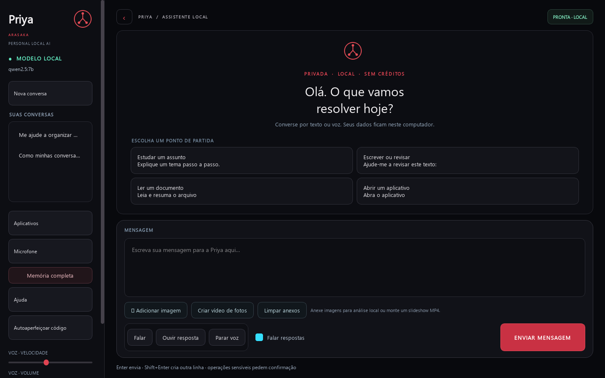
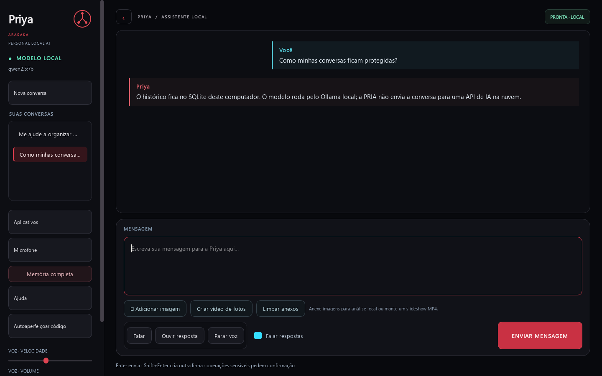

# PRIYA
### Assistente pessoal com inteligência artificial local

<p align="center">
  <strong>Uma assistente desktop para Windows, desenvolvida em Python e projetada para trabalhar com modelos de IA executados localmente.</strong>
</p>

<p align="center">
  
  
  
  
</p>

A **PRIYA** é um projeto de assistente pessoal desenvolvido para Windows. O núcleo em Python se comunica com modelos de linguagem servidos pelo [Ollama](https://ollama.com/), mantém histórico e memórias explícitas em SQLite e disponibiliza ferramentas locais para apoiar tarefas com arquivos, aplicativos e janelas do sistema.

O projeto reúne interface gráfica, comandos em português e módulos opcionais de voz e automação. A proposta é explorar uma arquitetura de IA local, com atenção à privacidade, à confirmação de ações sensíveis e à evolução incremental do software.

> **Estado do projeto:** em desenvolvimento. A disponibilidade de alguns recursos depende das bibliotecas, dos modelos e das configurações instaladas no computador.

---

## Índice

- [Principais recursos](#-principais-recursos)
- [Capturas e interface](#-capturas-e-interface)
- [Imagens e vídeos locais](#-imagens-e-videos-locais)
- [Tecnologias](#-tecnologias)
- [Como funciona](#-visão-geral-da-arquitetura)
- [Requisitos](#-requisitos)
- [Instalação](#-instalação)
- [Configuração](#-configuração)
- [Comandos](#-comandos-disponíveis)
- [Testes e diagnóstico](#-testes-e-diagnóstico)
- [Privacidade e segurança](#-privacidade-e-segurança)
- [Limitações e próximos passos](#-limitações-e-próximos-passos)

## ✨ Principais recursos

| Recurso | Descrição |
|---|---|
| Conversação com IA local | Integração com modelos servidos pelo Ollama. O modelo padrão configurado é `qwen2.5:7b`. |
| Memória local | Cada conversa fica em uma sessão separada no SQLite; o botão **Memória completa** abre um chat isolado com fatos e histórico disponíveis. |
| Interface desktop | Aplicação gráfica construída com PySide6 / Qt. |
| Imagens e vídeo local | Anexa imagens a um modelo de visão local e cria slideshow MP4 com FFmpeg. |
| Comandos em português | Comandos diretos e interpretação de solicitações para ferramentas locais. |
| Gerenciamento de arquivos | Ferramentas para listar, buscar, ler, criar, copiar, mover e renomear arquivos. |
| Aplicativos e janelas | Recursos para abrir aplicativos, listar janelas e interagir com elas mediante confirmação quando aplicável. |
| Automação assistida | Ferramentas de interação com janelas do Windows, como digitação e cliques. |
| Apoio à programação | Criação assistida de arquivos de código em uma área de projetos; o código gerado não é executado automaticamente. |
| Leitura de páginas públicas | Extração de conteúdo textual de URLs HTTP(S), recurso que requer conexão com a internet. |
| Voz opcional | Integração com Vosk (reconhecimento) e Piper (síntese), quando dependências e modelos estão instalados. |
| Autoaperfeiçoamento experimental | Propostas de alteração sujeitas a confirmação, backup e testes locais. |
| Informações locais verificadas | Consulta RAM, CPU, discos e GPUs no Windows; mostra VRAM NVIDIA quando disponível. |


## 🖼️ Capturas e interface

A interface mantém o tema escuro com acentos discretos em ciano e vermelho, organiza os controles de voz em um grupo com mais espaço entre botões e permite recolher a lateral. Em telas menores, a lateral pode ser rolada para manter os controles separados.

Cada entrada do histórico abre uma conversa própria; **Nova conversa** inicia outra sessão. **Memória completa** cria uma conversa separada com os fatos guardados e o histórico local disponível, sem misturar o conteúdo com os chats anteriores.

As capturas usam somente mensagens sintéticas e não incluem conteúdo do banco de dados pessoal.





Recrie as imagens de demonstração localmente com `python scripts\\capture_ui_previews.py`.

## 🎞️ Imagens e vídeos locais

- **Adicionar imagem** aceita PNG, JPG/JPEG, WEBP e BMP. Anexe até 4 imagens (15 MiB cada e 20 MiB no total) e escreva sua pergunta. Os arquivos são enviados somente ao Ollama em loopback; não são copiados ao SQLite.
- Para interpretação visual, instale uma vez um modelo de visão compatível, por exemplo `ollama pull qwen2.5vl:3b`. A Priya detecta modelos locais conhecidos ou usa `vision_model` em `config.json` / `PRIA_VISION_MODEL`. Sem um modelo compatível, informa a limitação sem iniciar downloads durante o chat.
- Depois da análise visual, o Ollama recebe instrução para descarregar o modelo (keep-alive zero), reduzindo disputa de RAM e VRAM com o modelo de texto. A qualidade depende do modelo e não é garantida.
- **Criar vídeo de fotos** gera um slideshow MP4 de até 20 imagens (300 MiB no total), 1 a 12 segundos por foto, resolução 1280×720. Usa FFmpeg local e não envia nada para a nuvem. O recurso cria uma sequência de fotos, sem animação generativa, narração, música ou transições. Não sobrescreve arquivos existentes.
- O instalador de dependências adiciona `imageio-ffmpeg`, que disponibiliza o FFmpeg local. A instalação precisa de internet uma vez; a criação de MP4 funciona depois sem rede.

## 🧰 Tecnologias

| Tecnologia | Responsabilidade |
|---|---|
| Python 3.10+ | Linguagem principal |
| Ollama | Execução local do modelo de linguagem |
| Qwen 2.5 7B | Modelo padrão configurado |
| SQLite | Armazenamento local de histórico e memórias |
| PySide6 / Qt | Interface gráfica desktop |
| Vosk / Piper | Recursos opcionais de voz |
| pywinauto | Automação opcional da interface do Windows |
| unittest | Testes automatizados |

## 🧠 Visão geral da arquitetura

A aplicação é organizada em módulos com responsabilidades separadas:

- **Core:** agente, comunicação com o modelo local e execução coordenada de tarefas.
- **Interface:** experiência desktop e interface de terminal.
- **Memory:** persistência de histórico e memórias em SQLite.
- **Tools:** recursos para arquivos, aplicativos, páginas web e automação.
- **Security:** controles relacionados à execução de ações.
- **Scripts:** instalação, inicialização e diagnóstico.

O fluxo principal utiliza o serviço local do Ollama. Recursos de consulta a páginas públicas são opcionais e dependem de internet; portanto, o projeto não deve ser descrito como totalmente offline em todos os cenários.

## 💻 Requisitos

- Windows 10 ou superior.
- Python 3.10 ou superior.
- [Ollama para Windows](https://ollama.com/download).
- Modelo `qwen2.5:7b disponível no Ollama.
- PySide6 para executar a interface gráfica.
- Dependências e modelos adicionais para recursos opcionais, como voz, leitura de documentos e automação.

## 🚀 Instalação

### 1. Clonar o repositório

```powershell
git clone https://github.com/lazaro3308/Local-IA--PRIYA.git
cd Local-IA--PRIYA
```

### 2. Verificar o ambiente

No PowerShell, execute o script de instalação/verificação incluído no projeto:

```powershell
.\scripts\install.ps1
```

### 3. Baixar o modelo local

```powershell
ollama pull qwen2.5:7b
```

Certifique-se de que o Ollama esteja em execução antes de iniciar a PRIYA.

### 4. Iniciar pelo terminal

```powershell
.\scripts\start.ps1
```

Como alternativa, a partir da raiz do repositório:

```powershell
python -m pria.main
```

### 5. Iniciar a interface gráfica

Com PySide6 instalado no mesmo ambiente Python:

```powershell
python -m pria.interface.desktop
```

## ⚙️ Configuração

A aplicação aceita um arquivo opcional `config.json` na raiz. Na ausência dele, utiliza os valores padrão definidos no projeto.

Exemplo de configuração:

```json
{
  "base_url": "http://127.0.0.1:11434",
  "model": "qwen2.5:7b",
  "vision_model": "",
  "timeout_seconds": 180,
  "context_window": 4096,
  "max_response_tokens": 256
}
```

Variáveis de ambiente reconhecidas:

| Variável | Finalidade |
|---|---|
| `PRIA_OLLAMA_URL` | Endereço do serviço Ollama |
| `PRIA_MODEL` | Nome do modelo utilizado |
| `PRIA_VISION_MODEL` | Modelo local opcional para analisar imagens |
| `PRIA_TIMEOUT` | Tempo limite das requisições |
| `PRIA_CONTEXT` | Tamanho da janela de contexto |
| `PRIA_MAX_RESPONSE_TOKENS` | Limite padrão de tokens da resposta |

A configuração descrita pelo projeto restringe o serviço do modelo a endereços locais (localhost/loopback).

## ⌨️ Comandos disponíveis

Use `/ajuda` no terminal da PRIYA para consultar a lista atualizada. Entre os comandos documentados estão:

| Comando | Descrição |
|---|---|
| `/ajuda` | Exibe a ajuda |
| `/apps` | Lista aplicativos reconhecidos |
| `/abrir-app <nome>` | Abre um aplicativo |
| `/listar [pasta]` | Lista arquivos de uma pasta |
| `/buscar <padrão> [pasta]` | Pesquisa arquivos |
| `/ler <arquivo>` | Lê um documento compatível |
| `/ler-web <URL>` | Extrai texto de uma página pública |
| `/janelas` | Lista janelas visíveis |
| `/guardar <texto>` | Salva uma memória explícita |
| `/memoria` | Consulta memórias locais |
| `/novo` | Inicia uma nova conversa |
| `/apagar-memoria` | Solicita a exclusão do histórico e das memórias |
| `/sair` | Encerra a aplicação |

Os comandos disponíveis podem variar conforme a configuração e a versão do projeto.

## 🧪 Testes e diagnóstico

Execute os testes automatizados a partir da raiz:

```powershell
python -m unittest discover -s tests -v
```

Para verificar o ambiente:

```powershell
python -m pria.diagnostics
```

## 🔐 Privacidade e segurança

O projeto foi estruturado com foco em execução local, mas recursos opcionais podem acessar a internet ou interagir com o sistema operacional.

- O histórico e as memórias explícitas são armazenados localmente em SQLite.
- A comunicação com o modelo é feita pelo serviço local do Ollama.
- A leitura de páginas públicas exige conexão com a internet.
- Ações sensíveis podem solicitar confirmação antes da execução.
- O acesso web valida URLs e bloqueia destinos locais/privados.
- Conteúdo de arquivos e páginas externas deve ser tratado como dado não confiável.
- O código produzido pela ferramenta de apoio à programação não deve ser executado automaticamente.
- Respostas que usam ferramentas locais mostram o resultado observado; falhas são identificadas como falhas.

**Importante:** automações e comandos do sistema podem modificar arquivos, janelas ou configurações do computador. Revise cada ação antes de autorizá-la. Não utilize a aplicação com permissões elevadas sem necessidade.

Nunca publique senhas, tokens, arquivos de configuração privados, bancos de dados pessoais ou informações sensíveis no repositório.

## 🛣️ Limitações e próximos passos

A PRIYA está em desenvolvimento. A qualidade das respostas depende do modelo escolhido, dos recursos de hardware e das configurações de contexto. Voz, leitura de documentos e automação podem exigir instalação adicional.

Possíveis frentes de evolução:

- ampliar a cobertura e a confiabilidade dos testes;
- melhorar a recuperação e organização da memória;
- aprimorar tratamento de erros e observabilidade;
- documentar permissões e escopos de cada ferramenta;
- ampliar a experiência de instalação e configuração.

## 📄 Licença e autoria

Consulte os termos e avisos de licença presentes no repositório e nas dependências utilizadas.

Desenvolvido por **lazaro3308** como projeto independente de estudo e experimentação em Python, IA local e automação para Windows.

<p align="center">
  <strong>PRIYA — inteligência local, ferramentas úteis e controle consciente.</strong>
</p>
